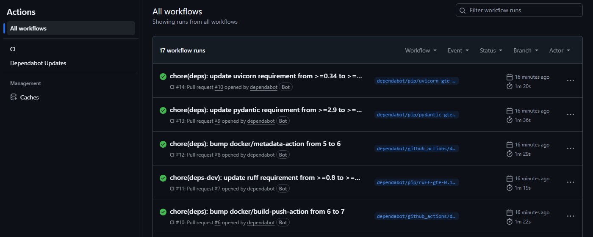

# DevOps Pipeline Lab

[](https://github.com/daviamarall/devops-pipeline-lab/actions/workflows/ci.yml)


Um serviço pequeno, mas **completo**, criado para demonstrar **ponta a ponta o ciclo de vida de CI/CD**: build, testes, lint, análise de segurança de imagem e publicação automatizada em registry — tudo orquestrado com **GitHub Actions** e **Docker**.

> Projeto de portfólio focado em **DevOps / SRE**. O objetivo não é a aplicação em si, e sim o **pipeline ao redor dela**.

---

## 🎯 O que este repositório demonstra

- **CI (Integração Contínua)** com GitHub Actions em múltiplos jobs e dependências (`needs`)
- **Lint de código** com `ruff`
- **Testes automatizados** com `pytest` (incluindo cobertura de endpoints e erros)
- **Build de imagem Docker** multi-etapa, com usuário não-root e `HEALTHCHECK`
- **Scan de vulnerabilidades** da imagem com **Trivy** (falha em `CRITICAL`/`HIGH`)
- **Publicação no GitHub Container Registry** (`ghcr.io`) com tags por SHA e `latest`
- **Health checks** (`/healthz`, `/readyz`) — padrão usado em Kubernetes
- **Docker Compose** para execução local
- Boas práticas de **12-Factor App** (config via variáveis de ambiente, logs em stdout)

## 🏗️ Arquitetura

```
┌─────────────┐     git push      ┌──────────────────────────────────────────────┐
│  Developer  │ ────────────────▶ │                GitHub Actions                 │
└─────────────┘                   │                                                │
                                   │  lint ──▶ test ──▶ docker build ──▶ trivy scan │
                                   │                          │                     │
                                   │                          ▼                     │
                                   │                 push → ghcr.io/…:sha & latest  │
                                   └──────────────────────────────────────────────┘
```

## ✅ Pipeline na prática

Cada push e pull request dispara o pipeline (lint → testes → build/scan da imagem → push no GHCR), mantendo o `main` sempre verde:



## 🚀 Como rodar localmente

### Com Docker Compose (recomendado)

```bash
docker compose up --build
# API disponível em http://localhost:8000/docs
```

### Com Python direto

```bash
python -m venv .venv
# Windows: .venv\Scripts\activate | Linux/macOS: source .venv/bin/activate
pip install -r requirements.txt -r requirements-dev.txt
uvicorn src.app.main:app --reload
```

### Testes e lint

```bash
pytest -q        # testes
ruff check src tests   # lint
```

## 🔌 Endpoints

| Método | Rota            | Descrição                          |
|--------|-----------------|------------------------------------|
| GET    | `/`             | Informações do serviço             |
| GET    | `/healthz`      | Liveness probe                     |
| GET    | `/readyz`       | Readiness probe                    |
| GET    | `/items`        | Lista itens em memória             |
| PUT    | `/items/{id}`   | Cria/atualiza um item              |
| GET    | `/items/{id}`   | Busca um item                      |
| DELETE | `/items/{id}`   | Remove um item                     |

Documentação interativa automática em `/docs` (Swagger) e `/redoc`.

## ⚙️ Variáveis de ambiente

| Variável      | Padrão    | Descrição                    |
|---------------|-----------|------------------------------|
| `APP_VERSION` | `1.0.0`   | Versão exposta pela API      |
| `ENVIRONMENT` | `local`   | Ambiente (`local`, `prod`…)  |

## 🧩 Etapas do pipeline (`ci.yml`)

| Job      | O que faz                                        | Depende de       |
|----------|--------------------------------------------------|------------------|
| `lint`   | `ruff check`                                     | —                |
| `test`   | `pytest`                                         | —                |
| `docker` | Build da imagem + **Trivy** (CRITICAL/HIGH)      | lint, test       |
| `push`   | Publica no `ghcr.io` (só em `main`)              | docker           |

## 📁 Estrutura

```
devops-pipeline-lab/
├── .github/workflows/ci.yml   # pipeline CI/CD
├── src/app/main.py            # aplicação FastAPI
├── tests/test_main.py         # testes
├── Dockerfile                 # imagem da aplicação
├── docker-compose.yml         # execução local
├── Makefile                   # atalhos de comandos
└── requirements*.txt
```

## 🛠️ Stack

Python · FastAPI · Uvicorn · Pytest · Ruff · Docker · Docker Compose · GitHub Actions · Trivy · GHCR

## 📄 Licença

MIT — veja [LICENSE](LICENSE).
